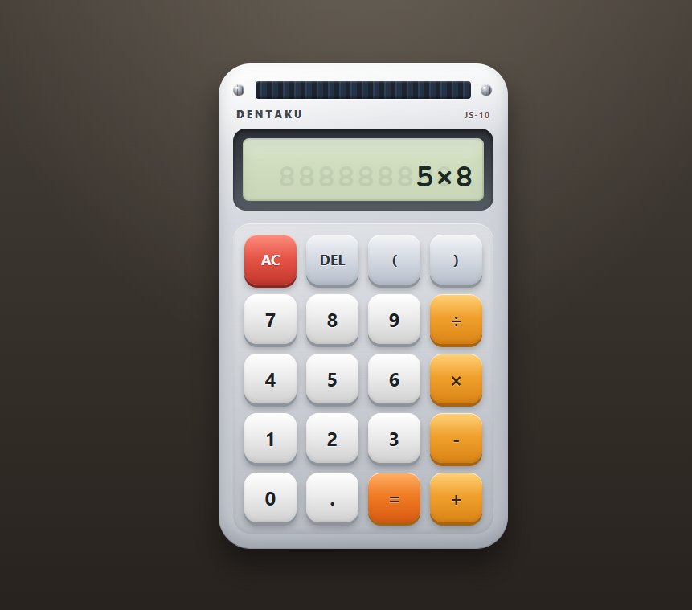

* web-dentaku

web-dentaku は GitHub Pages 上で動作する静的な電卓です。

** サイト

- https://jiro4989.github.io/web-dentaku/

** 使い方

ボタンを押すだけです。

** 開発

- コードを変更したら ~deno test~ すること
- 素の HTML、JS、CSS のみで実装すること
  - 依存性を増やしたくないため
  - 例外的に deno は使用する(テストランナー、フォーマッタ、リンターを内蔵しているため)
- Cursor で 99% 実装しました
- ~deno task start~ でローカルサーバーを起動してブラウザで確認できます
  - http://localhost:8000
